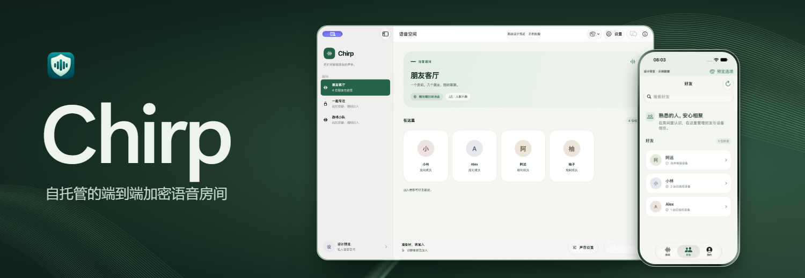
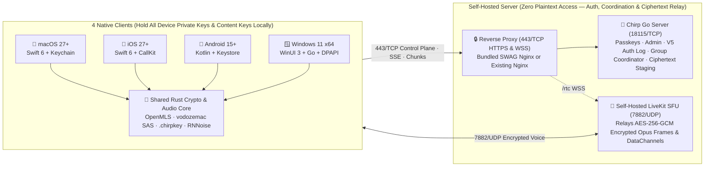

<div align="center">

<a href="https://chirp.youzifeile.com/en/">
  
</a>

# Chirp

**Self-Hosted · 4 Native Clients Ready · End-to-End Encrypted Voice Rooms**

<p>
  <a href="README.md"><strong>简体中文</strong></a>
  &nbsp;|&nbsp;
  <strong>English</strong>
</p>

<p>
  <a href="https://github.com/YouZiFeiLe/Chirp/releases"></a>
  <a href="https://github.com/YouZiFeiLe/Chirp/stargazers"></a>
  <a href="https://github.com/YouZiFeiLe/Chirp/commits/main"></a>
  <a href="https://hub.docker.com/r/youzifeile/chirp-server"></a>
  <a href="https://github.com/YouZiFeiLe/Chirp/issues"></a>
  <a href="LICENSE"></a>
</p>

<p>
  <a href="Client/apple/"></a>
  <a href="Client/apple/"></a>
  <a href="Client/android/"></a>
  <a href="Client/windows/"></a>
  <a href="Client/apple/MLS/native/"></a>
  <a href="https://chirp.youzifeile.com/en/"></a>
</p>

<p>
  <a href="https://chirp.youzifeile.com/en/hosting/"><strong>🚀 Self-Host Server</strong></a>
  &nbsp;·&nbsp;
  <a href="https://chirp.youzifeile.com/en/guide/first-call"><strong>🎙️ Your First Call</strong></a>
  &nbsp;·&nbsp;
  <a href="https://chirp.youzifeile.com/en/clients/shared-and-design"><strong>📱 4-Client Architecture</strong></a>
  &nbsp;·&nbsp;
  <a href="https://chirp.youzifeile.com/en/reference/architecture"><strong>🧱 System Architecture</strong></a>
  &nbsp;·&nbsp;
  <a href="https://chirp.youzifeile.com/en/reference/security-audit"><strong>🛡️ Security Review</strong></a>
</p>

<picture>
  <source media="(max-width: 600px)" srcset="Client/Branding/chirp-cover-mobile.webp">
  
</picture>

<sub>Cover shows an offline design preview of the Apple clients</sub>

</div>

---

## 👋 A Note from the Author & Why Chirp Exists

> I originally started building **Chirp** to replace the TeamSpeak setup I was using with friends.
>
> Not because TeamSpeak wasn't good—its audio quality and noise suppression really are great—but its biggest pain points were **no end-to-end encryption (E2EE)** and **closed source**. That's how **Chirp** was born: I kept the high bar for voice clarity and noise cancellation while lowering self-hosting friction and making everyday use as straightforward as possible without compromising security.
>
> Unlike Element, Chirp doesn't try to pack in dozens of flashy, heavyweight features. Instead, it gives you and your friends one focused place where you never have to worry about whether your voice calls are actually private.
>
> Audio transport runs over a self-hosted **LiveKit** SFU paired with **RNNoise** neural noise suppression across every client—in real daily calls with friends, the clarity and background cleanup feel genuinely great.
>
> **Huge thanks to Astra—and AI assistance—for making it possible for one solo developer to build the entire backend alongside all 4 native platform clients.** I've manually reviewed every single client screen and feature many times over, so everything should be solid—and if you do spot a rough edge or bug, please open an [Issue](https://github.com/YouZiFeiLe/Chirp/issues)!
>
> Whether your friends are on macOS, iOS, Android, or Windows, everyone joins the same encrypted rooms for live voice chat, ephemeral text messages, and secure file sharing (though personally I still wouldn't recommend using this as your main file-sharing drive… 😅).
>
> One person's time and energy only go so far—even with AI helping out, solo-maintaining one Go backend plus four native client apps is still a heavy lift. There is plenty of room to polish, so suggestions, ideas, and pull requests are all warmly welcome!

---

## 📱 All 4 Native Clients Built & Ready

Chirp ships **complete native clients across all 4 desktop and mobile platforms**, sharing a single **Rust OpenMLS + vodozemac SAS** crypto core and the unified *Chirp — Together* design system:

| Client | Minimum OS & Arch | Stack & Security Highlights | Distribution & Compatibility Notes | Source |
| :--- | :--- | :--- | :--- | :--- |
| **macOS** | **macOS 27+**<br>Apple Silicon (`arm64`) | Swift 6 Strict Concurrency · SwiftUI · Data Protection Keychain · RNNoise | Open-source `.dmg` builds are developer-signed and **Apple Notarized**; closing windows keeps active calls running | [`Client/apple`](Client/apple/) |
| **iOS** | **iOS 27+**<br>`arm64` | Shares 90%+ core logic with macOS · CallKit · Data Protection Keychain | Distributed as `.ipa` outside the App Store; re-sign with your Apple Developer or sideloading workflow | [`Client/apple`](Client/apple/) |
| **Android** | **Android 15 (API 35)+**<br>`arm64-v8a` / `x86_64` | Kotlin · Jetpack Compose · Material 3 · Core-Telecom · Android Keystore AES-GCM · C++ JNI | Universal APK bundling both ABIs; heavily customized OEM Android forks may show compatibility quirks | [`Client/android`](Client/android/) |
| **Windows** | **Windows 11 24H2+**<br>`x64` (`Build ≥ 26100`) | **C# / WinUI 3** UI + **Go protocol subprocess** (anonymous `stdin/stdout`, zero local ports) + **DPAPI** + Rust Sonora AEC3 | `Setup.exe` and `MSIX` installers; Windows on Arm64 has not been tested yet | [`Client/windows`](Client/windows/) |

> [!TIP]
> **Full cross-platform parity**: Passkey passwordless login + phone QR sign-in · Pairwise 3-group SAS safety code verification · Seamless 60s dual-slot OpenMLS key rotation · Ephemeral encrypted text chat (zero server storage) · Chunked E2EE file attachments.

---

## 🧭 System Architecture



---

## ⚡ Quick Self-Hosting

Bring up the entire stack on any Linux host with **Docker Compose 2.26+** following the [Getting Started Guide](https://chirp.youzifeile.com/en/hosting/):

<details>
<summary>Expand quick Docker Compose commands & repository map</summary>

```sh
mkdir -p ~/chirp && cd ~/chirp
curl -fL https://raw.githubusercontent.com/YouZiFeiLe/Chirp/main/compose.yaml -o compose.yaml
# Configure .env for bundled HTTP-01 / DNS-01 HTTPS or an existing Nginx proxy
sudo docker compose up -d --wait --wait-timeout 600
```

| Directory | Purpose |
| :--- | :--- |
| [`cmd/`](cmd/) & [`internal/`](internal/) | Go backend CLI, Passkey/WebAuthn portals, admin console, V5 authorization log, and OpenMLS coordinator |
| [`Client/apple/`](Client/apple/) | macOS & iOS SwiftUI apps plus [`MLS/native/`](Client/apple/MLS/native/) shared Rust core |
| [`Client/android/`](Client/android/) | Android Kotlin / Jetpack Compose / C++ JNI app & release signing setup |
| [`Client/windows/`](Client/windows/) | Windows C# WinUI 3 shell, Go protocol subprocess & Rust Sonora audio processing |
| [`deploy/`](deploy/) & [`compose.yaml`](compose.yaml) | Public production Compose, Nginx templates & `FROM scratch` Dockerfile |
| [`scripts/`](scripts/) | Dependency prep & automated integration test scripts |

</details>

---

## 📚 Full Documentation Site

Deployment guides, per-platform client architecture, the V5 E2EE protocol spec, `.chirpkey` / `.chirplog` formats, security review notes, and build instructions all live on the documentation portal:

- 📖 **English Docs**: **[https://chirp.youzifeile.com/en/](https://chirp.youzifeile.com/en/)**
- 📖 **中文文档**: **[https://chirp.youzifeile.com](https://chirp.youzifeile.com)**

| Looking to… | Recommended Starting Points |
| :--- | :--- |
| 🎙️ **Join a friend's server** | [First Call](https://chirp.youzifeile.com/en/guide/first-call) · [Installing Clients](https://chirp.youzifeile.com/en/guide/clients) · [Devices & Recovery](https://chirp.youzifeile.com/en/guide/devices) |
| 🖥️ **Self-host your own instance** | [Getting Started](https://chirp.youzifeile.com/en/hosting/) · [Admin Console Guide](https://chirp.youzifeile.com/en/hosting/admin-console) · [Troubleshooting](https://chirp.youzifeile.com/en/hosting/troubleshooting) |
| 🔐 **Audit E2EE & client internals** | [System Architecture](https://chirp.youzifeile.com/en/reference/architecture) · [Security Audit & E2EE Review](https://chirp.youzifeile.com/en/reference/security-audit) · [V5 Protocol](https://chirp.youzifeile.com/en/reference/e2ee-v5) |
| 🛠️ **Build from source & test** | [Server Build & Testing](https://chirp.youzifeile.com/en/development/building) · [Native Client Builds](https://chirp.youzifeile.com/en/development/clients) · [Manual QA Checklist](https://chirp.youzifeile.com/en/development/testing) |

---

## 📈 Repository Activity & License

<div align="center">

<a href="https://star-history.com/#YouZiFeiLe/Chirp&Date">
  <picture>
    <source media="(prefers-color-scheme: dark)" srcset="https://api.star-history.com/svg?repos=YouZiFeiLe/Chirp&type=Date&theme=dark" />
    <source media="(prefers-color-scheme: light)" srcset="https://api.star-history.com/svg?repos=YouZiFeiLe/Chirp&type=Date" />
    
  </picture>
</a>

</div>

<p align="center">
  Original work in Chirp is licensed under the <a href="LICENSE"><strong>GNU Affero General Public License v3.0 (AGPL-3.0-only)</strong></a>.<br>
  If Chirp helps you and your friends talk securely, consider leaving a ⭐ Star!
</p>
