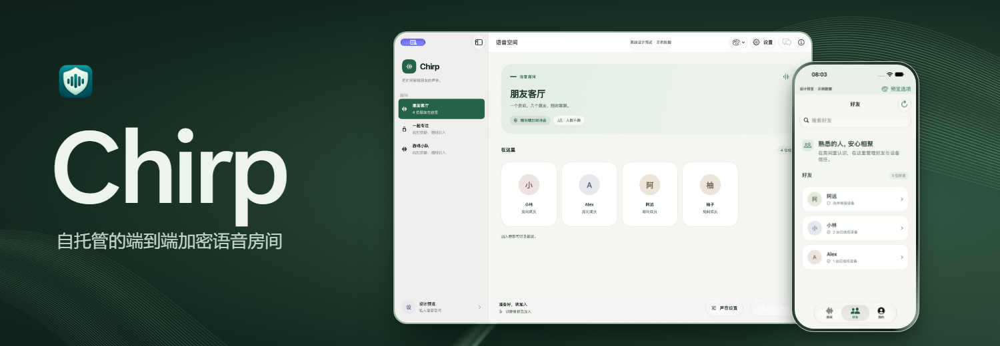

<h1>
  <picture>
    <source media="(max-width: 600px)" srcset="docs/assets/readme/chirp-cover-mobile.webp">
    
  </picture>
</h1>

封面为 Apple 客户端的离线示例（其他平台客户端截图暂未更新）<a href="design-system/chirp-together/previews/mac-room-light.png">macOS 房间原图</a> · <a href="design-system/chirp-together/previews/apple-settings-2026-11-17/ios-friends-light.jpg">iOS 好友原图</a>

## 开发者：

我开发**Chirp**的初衷是想替代掉正在使用的Teamspeak。

并不是说Teamspeak不够好，TS的音质和降噪效果确实不错，但是它最大的痛点就是没有E2EE，并且代码并不开源。 

于是乎便有了**Chirp**，我维持了高水准的音质水平和降噪体验，并且尽可能的降低了部署难度，也尽可能的在保证安全性的前提下提升易用性。

它不像是Element那样有着许多花哨的功能，但是它足以让你和你的朋友不再因为语音安全性而烦恼。

音质方面由独立部署的Livekit负责，同时我也为它接入了RNNoise降噪算法，我自己感觉音质和降噪效果都很不错。

还好有Astra大人，我可以自己一人把4个客户端都搓出来。每个客户端的功能和页面我都人工复查过多次，应该或许不会有什么问题了。如果有的话，烦请提交issues。

macOS、iOS、Android、Windows 各个客户端功能统一，均可在同一间房里语音聊天、发文字或分享文件。（虽然我不太推荐使用这个来分享文件...）

当前项目可能还有很多不够完美的地方，我一个人精力实在有限，哪怕有Ai协助，一个人维护一套后端和四个客户端还是有点太吃力了，所以如果大家有任何建议或者想法，都欢迎提出，也欢迎大家贡献代码。

**[从零部署](deploy/README.md)** · [加入已有服务器](docs/using-chirp.md) · [技术架构](docs/architecture.md)

### 当前客户端限制的最低操作系统版本

| 客户端 | 最低操作系统版本 | 安装与兼容性说明 |
| --- | --- | --- |
| iOS | iOS 27 | `.ipa` 文件需个人签名后安装使用 |
| Mac | macOS 27 | `.dmg` 文件已经过分发签名和 Apple 公证，可以直接安装使用 |
| Windows | Windows 11 | 暂未测试 Arm 平台上的软件兼容性 |
| Android | Android 15 | OEM 魔改版安卓/类安卓系统可能无法正常使用 |

### 在自己的服务器上部署

推荐使用 **Debian 13 x86_64**。按部署指南准备好域名和 `.env` 后，Docker Compose 会拉取成品镜像并启动服务。指南也包含创建首位管理员的步骤。[Compose 文件](compose.yaml) · [Docker Hub 版本](https://hub.docker.com/r/youzifeile/chirp-server/tags)

- 如果**已有 Nginx 和 HTTPS 证书**，启动 Chirp 和 LiveKit 两个后端，让原有站点转发业务和通话信令。[接入已有 Nginx](deploy/README.md#使用已有-nginx-和证书)
- 如果**首次配置 HTTPS**，可以让 Compose 一起启动 Nginx，通过 HTTP-01 或 DNS-01 自动申请和续期证书。[使用内置 Nginx](deploy/README.md#使用内置-nginx)

### 第一次和朋友通话

1. 向管理员取得服务器的 HTTPS 地址和配套客户端。在浏览器登记通行密钥（Passkey），将申请编号发给管理员。
2. 获批后，在客户端登录并和朋友加入同一间房。首次同房时，当面或通过另一条可信渠道，逐组比对双方设备上显示的三组安全码。完成互认、房间就绪后就能开麦。

聊天记录随离房清空。遇到想留下的照片或文件，可以在离房前导出。[成员使用指南](docs/using-chirp.md) · [文件传输规则](docs/attachments.md)

### 开发与发布

Go 服务端处理账号和房间准入，LiveKit 转发加密媒体，原生客户端负责核验设备和管理房间密钥。架构指南沿着一次登录、入房和通话串起这些组件，并链接到对应源码。[开发者架构指南](docs/architecture.md) · [本地开发与测试](docs/development.md) · [安全设计](docs/security.md) · [维护者发布说明](docs/publishing.md)

## 开源许可证

Chirp 的原创内容采用 **GNU Affero General Public License 第 3 版（仅此版本，`AGPL-3.0-only`）**，允许商业使用。分发受此许可证覆盖的二进制程序或镜像时，须按第 6 条向接收者提供对应源码或取得源码的途径。若修改 Chirp 并将修改版作为网络服务运行，第 13 条要求向所有与该版本远程交互的用户显著提供免费获取该版本对应源码的途径。[许可证全文](LICENSE)

第三方组件沿用各自的许可证和版权声明。[LiveKit](Client/android/livekit/src/main/assets/licenses/livekit/LICENSE) · [RNNoise](Client/apple/Audio/Sources/ChirpAudio/RNNoise-LICENSE.txt) · [MLS 依赖许可清单](Client/apple/MLS/Sources/ChirpMLS/Resources/ThirdPartyNotices.txt)
