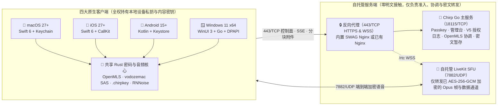

<div align="center">

<a href="https://chirp.youzifeile.com">
  
</a>

# Chirp

**自托管 · 全平台四端原生 · 端到端加密（E2EE）语音房间**

<p>
  <strong>简体中文</strong>
  &nbsp;|&nbsp;
  <a href="README.en.md"><strong>English</strong></a>
</p>

<p>
  <a href="https://github.com/YouZiFeiLe/Chirp/releases"></a>
  <a href="https://github.com/YouZiFeiLe/Chirp/stargazers"></a>
  <a href="https://github.com/YouZiFeiLe/Chirp/commits/main"></a>
  <a href="https://hub.docker.com/r/youzifeile/chirp-server"></a>
  <a href="https://github.com/YouZiFeiLe/Chirp/issues"></a>
  <a href="LICENSE"></a>
</p>

<p>
  <a href="Client/apple/"></a>
  <a href="Client/apple/"></a>
  <a href="Client/android/"></a>
  <a href="Client/windows/"></a>
  <a href="Client/apple/MLS/native/"></a>
  <a href="https://chirp.youzifeile.com"></a>
</p>

<p>
  <a href="https://chirp.youzifeile.com/hosting/"><strong>🚀 从零部署服务端</strong></a>
  &nbsp;·&nbsp;
  <a href="https://chirp.youzifeile.com/guide/first-call"><strong>🎙️ 第一次通话</strong></a>
  &nbsp;·&nbsp;
  <a href="https://chirp.youzifeile.com/clients/shared-and-design"><strong>📱 四端架构介绍</strong></a>
  &nbsp;·&nbsp;
  <a href="https://chirp.youzifeile.com/reference/architecture"><strong>🧱 系统架构</strong></a>
  &nbsp;·&nbsp;
  <a href="https://chirp.youzifeile.com/reference/security-audit"><strong>🛡️ 安全评估报告</strong></a>
</p>

<picture>
  <source media="(max-width: 600px)" srcset="Client/Branding/chirp-cover-mobile.webp">
  
</picture>

<sub>封面为 Apple 客户端离线设计预览示例</sub>

</div>

---

> **合规与法律声明**
>
> 本项目以技术分享为目的，作者不运营任何公开通信服务、不提供持续技术支持、不获取收入或对价。使用本项目前，请阅读 [`COMPLIANCE.md`](./COMPLIANCE.md)，其中包含项目定位、密码学出口管制、GDPR 对接说明及中国法下的使用边界。使用、复制、分发或部署本项目，即表示你已阅读并理解该文件全部内容。

## 👋 开发者的话 & 项目初衷

> 我开发 **Chirp** 的初衷，其实是想替代掉自己一直在使用的 TeamSpeak。
>
> 并不是说 TeamSpeak 不够好——相反，TS 的音质和降噪表现确实非常出色；但它最大的痛点是没有**端到端加密（E2EE）**，而且代码并不开源。于是乎便有了 **Chirp**：我尽全力维持了同样高水准的音质和降噪体验，并在保证加密安全性的前提下，尽可能降低自托管部署难度、打磨日常使用的易用性。
>
> 它不像 Element 那样堆砌大量花哨却沉重的功能，但它足以让你和身边的朋友放心地待在同一个语音房里，不再为「通话安不安全」而烦恼。
>
> 音质与媒体转发由独立部署的 **LiveKit** 负责，同时我还为各个端统一接入了深度学习开源降噪算法 **RNNoise**，我自己实际开黑用下来的音质和降噪效果都很不错。
>
> **还好有 Astra 大人，再加上 AI 的协助，我终于能够凭一己之力把服务端和全部 4 个平台的原生客户端都完整搓了出来。** 每个客户端的功能细节和界面我都人工复查过很多次，日常开黑已经基本稳当——如果还是发现了 Bug 或体验不够顺手的地方，烦请随手提一个 [Issue](https://github.com/YouZiFeiLe/Chirp/issues)。
>
> 现在无论你和朋友用 macOS、iOS、Android 还是 Windows，都可以直接进入同一间语音房实时通话、发送临时文字消息或安全分享文件（虽然我不太推荐使用这个来分享大文件……😂）。
>
> 不过一个人精力实在有限，哪怕有 AI 协助，独自同时维护一套 Go 后端和四个平台的原生客户端还是非常吃力。这个项目肯定还有很多不够完美的地方，如果你有任何建议、想法或者优化思路，非常欢迎提出，也十分欢迎直接提交 PR 一起完善它！

---

## 📱 四大原生客户端已全部就绪

Chirp **全平台 4 个原生客户端均已完成开发并实现协议与体验统一**，共享同一套 **Rust OpenMLS + vodozemac SAS** 密码学内核与统一的「Chirp — Together」设计语言：

| 平台客户端 | 最低系统要求 | 技术实现与加密隔离 | 安装包与兼容性说明 | 源码入口 |
| :--- | :--- | :--- | :--- | :--- |
| **macOS** | **macOS 27+**<br>Apple Silicon (`arm64`) | Swift 6 严格并发 · SwiftUI · Data Protection Keychain · RNNoise | 开源发布版 `.dmg` 已签名并通过 **Apple 公证（Notarization）**，拖入应用即可运行；关闭窗口保留后台通话 | [`Client/apple`](Client/apple/) |
| **iOS** | **iOS 27+**<br>`arm64` | 与 macOS 共用 90%+ 核心业务 · CallKit · Data Protection Keychain | 提供 `.ipa` 安装包，暂未上架 App Store，需使用你的 Apple 开发者/自签工具签名安装 | [`Client/apple`](Client/apple/) |
| **Android** | **Android 15 (API 35)+**<br>`arm64-v8a` / `x86_64` | Kotlin · Jetpack Compose · Material 3 · Core-Telecom · Android Keystore AES-GCM · C++ JNI | 单包内置双 ABI；部分深度魔改的 OEM 类安卓系统可能存在前台保活或 Passkey 兼容差异 | [`Client/android`](Client/android/) |
| **Windows** | **Windows 11 24H2+**<br>`x64` (`Build ≥ 26100`) | **C# / WinUI 3** 界面 + **Go 协议子进程**（`stdin/stdout` 管道，零本地端口）+ **DPAPI** + Rust Sonora AEC3 | 提供 `Setup.exe` / `MSIX`；暂未测试 Arm64 Windows 兼容性 | [`Client/windows`](Client/windows/) |

> [!TIP]
> **全端核心能力一致**：Passkey 无密码认证 + 跨设备二维码登录 · 房间内 3 组安全码（SAS）设备互认 · OpenMLS 60 秒双槽平滑不停麦换钥 · 基于 WebRTC 临时密文文字聊天（服务器零存库） · 分块端到端加密附件传输。

---

## 🧭 整体技术架构



---

## ⚡ 快速自托管部署

仅需一台 Linux 主机与 **Docker Compose 2.26+**，按[从零部署文档](https://chirp.youzifeile.com/hosting/)即可一条命令拉起整套服务（含自动 HTTPS 证书签发）：

<details>
<summary>展开查看快速启动步骤与仓库目录速览</summary>

```sh
mkdir -p ~/chirp && cd ~/chirp
curl -fL https://raw.githubusercontent.com/YouZiFeiLe/Chirp/main/compose.yaml -o compose.yaml
# 按文档配置 .env（内置 HTTP-01 / DNS-01 自动 HTTPS 或接入已有 Nginx）
sudo docker compose up -d --wait --wait-timeout 600
```

| 目录 | 说明 |
| :--- | :--- |
| [`cmd/`](cmd/) & [`internal/`](internal/) | Go 服务端入口、Passkey/WebAuthn 认证、管理台、V5 授权服务、房间与 OpenMLS 群组协调器 |
| [`Client/apple/`](Client/apple/) | macOS & iOS SwiftUI 客户端工程，以及 [`MLS/native/`](Client/apple/MLS/native/) 四端共用 Rust 核心库 |
| [`Client/android/`](Client/android/) | Android Kotlin / Jetpack Compose / C++ JNI 客户端工程与开源发布签名配置 |
| [`Client/windows/`](Client/windows/) | Windows C# WinUI 3 桌面壳、Go 协议子进程与 Rust Sonora 音频处理模块 |
| [`deploy/`](deploy/) & [`compose.yaml`](compose.yaml) | 公开生产成品镜像 Compose、Nginx 反代模板与 `FROM scratch` 容器构建文件 |
| [`scripts/`](scripts/) | 依赖准备、自动化回归测试与端到端联调脚本 |

</details>

---

## 📚 完整知识库文档

项目的部署运维、多端架构详解、V5 端到端加密协议规范、`.chirpkey` / `.chirplog` 文件格式、安全扫描报告以及编译测试指南均已整理在独立知识库站点中：

- 📖 **中文知识库**：**[https://chirp.youzifeile.com](https://chirp.youzifeile.com)**
- 📖 **English Docs**：**[https://chirp.youzifeile.com/en/](https://chirp.youzifeile.com/en/)**

| 想做什么？ | 推荐直达页面 |
| :--- | :--- |
| 🎙️ **加入朋友的服务器开黑** | [第一次通话](https://chirp.youzifeile.com/guide/first-call) · [选择和安装客户端](https://chirp.youzifeile.com/guide/clients) · [设备备份与恢复](https://chirp.youzifeile.com/guide/devices) |
| 🖥️ **在自己的服务器上搭建 Chirp** | [从零部署](https://chirp.youzifeile.com/hosting/) · [管理台指南](https://chirp.youzifeile.com/hosting/admin-console) · [故障排查](https://chirp.youzifeile.com/hosting/troubleshooting) |
| 🔐 **审计安全架构与四端实现** | [系统架构](https://chirp.youzifeile.com/reference/architecture) · [安全扫描与加密链路评估报告](https://chirp.youzifeile.com/reference/security-audit) · [Chirp V5 协议](https://chirp.youzifeile.com/reference/e2ee-v5) |
| 🛠️ **从源码构建或二次开发** | [服务端本地构建](https://chirp.youzifeile.com/development/building) · [各平台客户端构建](https://chirp.youzifeile.com/development/clients) · [人工验收清单](https://chirp.youzifeile.com/development/testing) |

---

## 📈 仓库动态与开源协议

<div align="center">

<a href="https://star-history.com/#YouZiFeiLe/Chirp&Date">
  <picture>
    <source media="(prefers-color-scheme: dark)" srcset="https://api.star-history.com/svg?repos=YouZiFeiLe/Chirp&type=Date&theme=dark" />
    <source media="(prefers-color-scheme: light)" srcset="https://api.star-history.com/svg?repos=YouZiFeiLe/Chirp&type=Date" />
    
  </picture>
</a>

</div>

<p align="center">
  Chirp 的原创内容采用 <a href="LICENSE"><strong>GNU Affero General Public License v3.0（AGPL-3.0-only）</strong></a> 开源许可。<br>
  如果这个项目对你和朋友有帮助，欢迎点亮右上角的 ⭐ Star！
</p>
