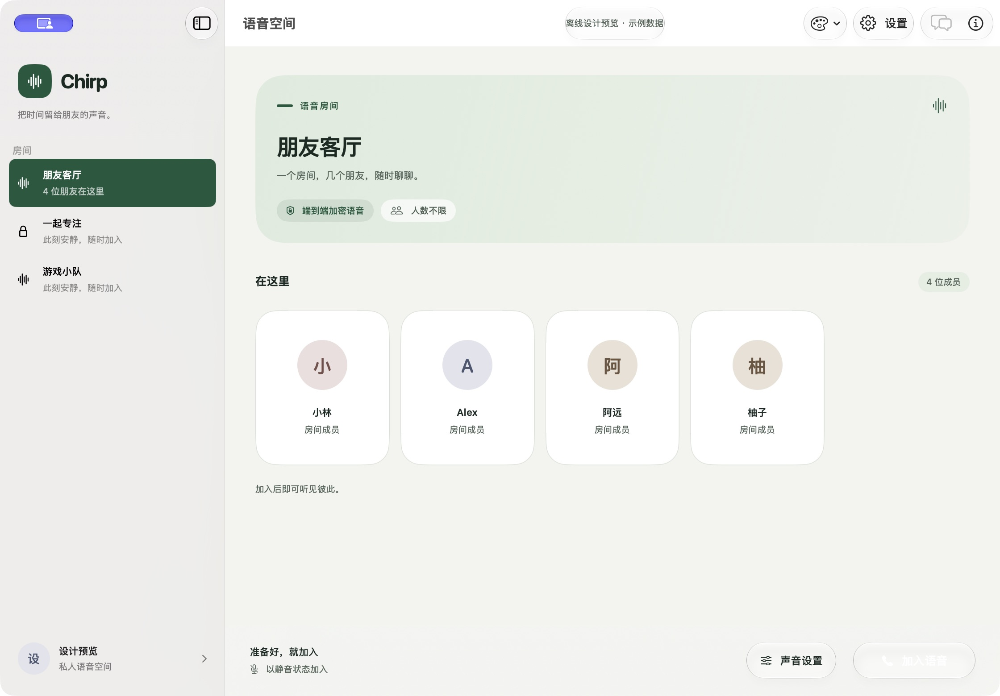
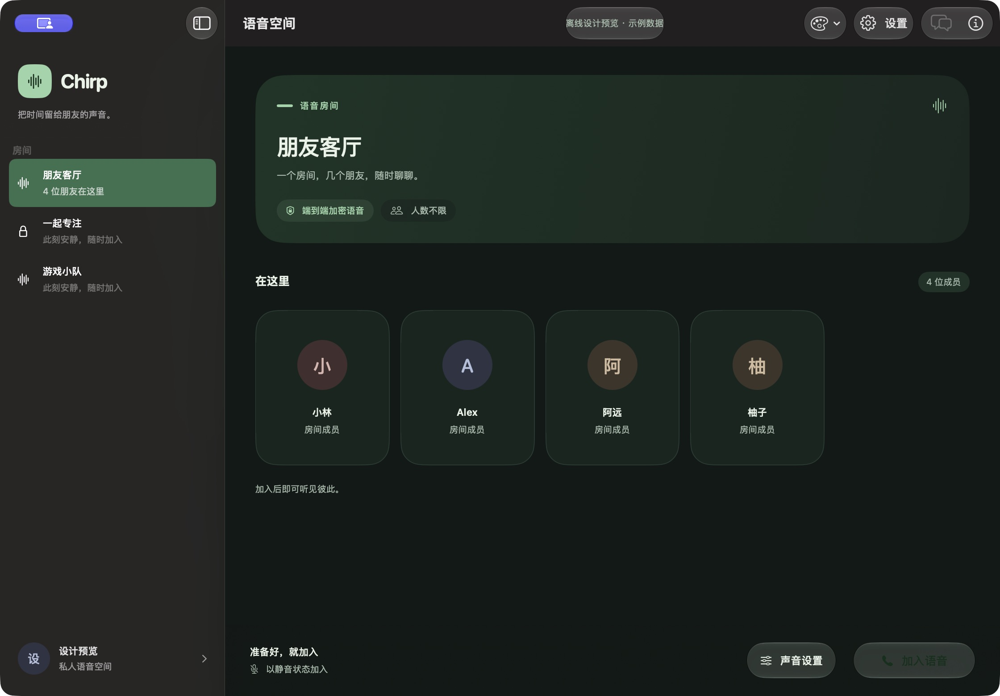
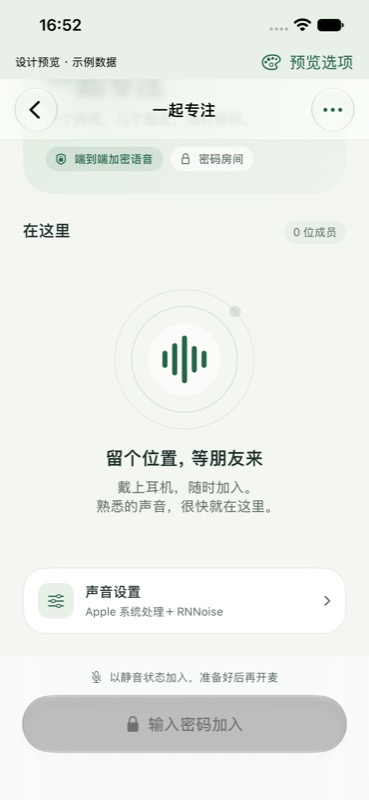
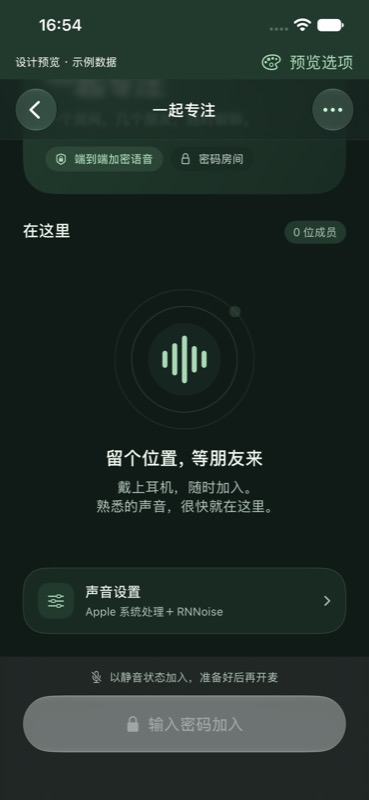

# Chirp · Together 设计与交接入口

本目录维护跨平台设计规范、令牌、参考截图、离线网页预览和适配交接，并链接各客户端的设计说明。

| 开始做什么 | 先读什么 |
| --- | --- |
| 理解家族设计与交互规则 | [MASTER.md](MASTER.md) |
| 接手 Windows／Android 设计 | [HANDOFF.md](HANDOFF.md) |
| 参照 Mac 实现原生 Windows 客户端 | [Windows 适配规范](../../Client/windows/doc/winui-design.md) |
| 实现与复核 Android Material 3 界面 | [Android 适配规范](pages/android.md) |
| 获取颜色、尺寸与布局数据 | [design-tokens.json](design-tokens.json)，当前 version 2 |
| 浏览全部截图、来源与限制 | [截图索引](previews/README.md) · [早期 Apple／网页截图清单](previews/manifest.json) · [Apple 设置与好友](previews/apple-settings-2026-11-17/manifest.json) · [Windows 桌面](previews/windows-2026-11-19/manifest.json) |

## Mac 基准截图

两张图均拍摄于 2026-11-16，来自实际 macOS SwiftUI Debug 应用的离线房间预览；逻辑窗口为 1120 × 780 pt，截图为 Retina 2×。Windows 适配应按逻辑尺寸与结构重建；当前好友入口和独立设置窗口以 [2026-11-17 截图](previews/apple-settings-2026-11-17/README.md)及源码为准。

| 浅色 | 深色 |
| --- | --- |
|  |  |

预览中「加入语音」与聊天入口被主动禁用。它们的灰色样式表示离线示例状态，不是正式客户端主操作的目标配色。正式按钮、状态与三栏聊天规则见 [Windows 规范](../../Client/windows/doc/winui-design.md)。

## iOS 空房间截图

正常字号，来自 iPhone 17e 模拟器。下图为滚动底部的状态，完整展示空状态与声音设置；完整房间标题见[顶部浅色](previews/ios-empty-overview-light.jpg)／[顶部深色](previews/ios-empty-overview-dark.jpg)。

| 浅色 | 深色 |
| --- | --- |
|  |  |

这组空房间图记录 2026-11-16 的布局。iOS 和 Android 当前均使用「房间／好友／我的」三个标签。导航与设置的参考画面见 [2026-11-17 截图](previews/apple-settings-2026-11-17/README.md)。

## 跨平台离线网页预览

需要 Python 3.9 或更新版本，无第三方依赖。从仓库根目录运行：

```sh
python3 design-system/chirp-together/preview-web.py
```

Windows PowerShell 使用：

```powershell
python.exe .\design-system\chirp-together\preview-web.py
```

打开 [登录与注册](http://127.0.0.1:18761/) 或 [管理台](http://127.0.0.1:18762/admin/)。端口冲突时使用 `--passkey-port 18861 --admin-port 18862`。脚本按文件位置定位仓库，可从其他工作目录启动；读取真实网页资源，仅提供合成数据，写请求统一返回 405。

可用示例：`/?appearance=dark`、`/register?appearance=light`、`/register?state=receipt`、`/?state=signed-in`。这些网页用于验证共享品牌与认证流程；Windows 桌面布局以 Mac 基准为准。

网页预览中的版本号和账号均为固定示例，不代表当前发行版本。脚本未提供管理台设备列表与黑名单的 GET fixture，这些入口会返回 404，不能据此验收身份管理页面。

Mac 本地复查使用仓库已有入口：

```sh
./scripts/build_and_run.sh --design-preview
```

在「预览选项 → 外观」切换浅深色，在侧栏选择密码房间查看空状态，打开「组件参考」查看成员说话／静音与聊天气泡。「窗口尺寸」提供默认与最小窗口预设，实际尺寸见截图索引。查看当前房间公共信息或设备互认时，分别在命令后追加 `--room-information-preview` 或 `--device-verification-preview`。Windows 桌面的界面、窗口缩放和操作可直接对照 WinUI 源码与实机截图。[Apple 离线预览](../../docs/development.md#设计图标与离线预览) · [Windows 平台规范](../../Client/windows/doc/winui-design.md)
