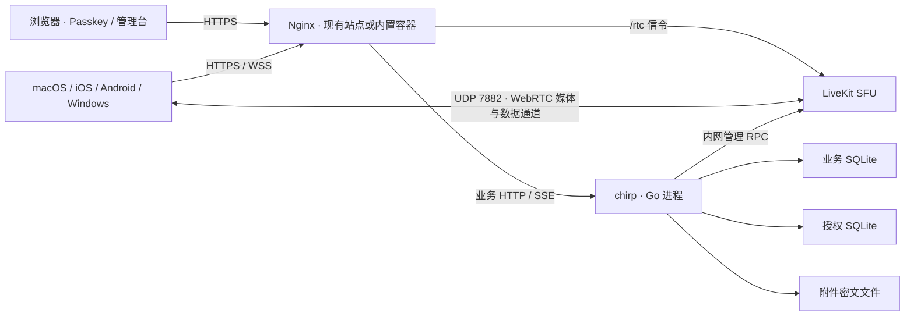

# 开发者架构指南

Chirp 用 Go 处理账号、房间准入和群组协调，用 LiveKit 转发实时流量，在原生客户端核验设备并完成端到端加密。读完本页可沿源码追踪一次登录、入房和发送，或按主题进入协议和平台手册。搭建成品服务请直接阅读[快速部署指南](../deploy/README.md)。

## 组件与数据流

公网的 HTTPS/WSS 入口可以是已有的 Nginx 站点，也可以是 Compose 的 `https` profile 启动的 Nginx/Certbot 容器。两种入口都在 443/TCP 终止 TLS，将 `/rtc` 及其子路径转给 LiveKit（7880/TCP），其余业务请求与 SSE 转给 app（18115/TCP）。通话媒体经 7882/UDP 直达 LiveKit。`CHIRP_PUBLIC_ORIGIN` 决定 WebAuthn 的 Origin 与 RP ID、发现端点和公开信令地址。本地开发可通过宿主机回环端口访问两个后端。[Compose 与路由](../compose.yaml) · [端点派生](../internal/config/config.go) · [证书与反代运维](server-operations.md)

| 从哪个模块开始 | 职责 |
| --- | --- |
| [命令行](../cmd/chirp/main.go) → [应用组装](../internal/application/application.go) | 启动存储、媒体管理客户端与后台任务，将路由装入同一个 HTTP 服务。CLI 也提供管理员引导和授权公钥校验。 |
| [Passkey](../internal/passkeyhttp/server.go) · [管理台](../internal/adminhttp/server.go) · [网页资源](../internal/webui/assets.go) | 浏览器完成注册、登录及手机授权，管理员审批成员和管理房间。网页由 Go 嵌入并提供。 |
| [业务 API](../internal/httpapi/server.go) · [Store](../internal/store/store.go) | 处理客户端发现、资料、目录、房间、附件和设备接口。Store 在事务中检查登录、设备和入房资格。 |
| [设备身份](../internal/identity/protocol.go) · [签名授权](../internal/authorization/protocol.go) | 身份协议定义证书、签名和名单绑定。授权模块验证事件并为带随机挑战的历史快照签名。 |
| [群组协调器](../internal/group/hub.go) · [请求验证](../internal/group/action.go) | 每房维护成员、配钥和轮换状态，转发 KeyPackage、加密 Welcome 和成员确认，符合条件时签发短期媒体许可。 |
| [媒体服务](../internal/room/service.go) · [房间目录](../internal/room/directory.go) | 签发绑定房间和参与者的 LiveKit JWT，通过内网 RPC 查询或移出参与者，合并业务房间配置与在线状态。 |

## 从发现到登录

1. 客户端请求 `GET /v1/client-config`，各发送一个 `X-Chirp-Platform`、`X-Chirp-Version`、`X-Chirp-Build` 头。发现协议为 v5，响应包含 `passkey_origin`、`endpoints`、能力和平台版本策略。最低版本控制准入，最新版本用于提示。初始策略来自数据库，管理员可调整。[发现响应](../internal/httpapi/client_config.go) · [版本校验](../internal/clienthttp/version.go) · [端点定义](../internal/config/client.go)
2. 成员在浏览器用 Passkey 登录。原生客户端采用浏览器回调的授权码或跨设备扫码轮询，均以 S256 PKCE 绑定发起客户端。兑换后得到五分钟的身份设置授权。首次设置须保存加密恢复文件，换机可导入该文件或请有效旧设备批准配对。[Passkey 路由](../internal/passkeyhttp/server.go) · [服务端身份设置](../internal/store/identity_setup.go) · [恢复文件格式](chirpkey.md)
3. 客户端在 `/api/client/identity/challenge` 和 `/api/client/identity/complete` 证明持有目标设备私钥。成功后服务端在事务中发放业务 Bearer，替换同一账号的旧业务登录，期限取 20 小时与设备证书剩余有效期的较小值。浏览器管理员操作另行校验 Cookie、成员状态及角色。[凭据签发](../internal/store/client_login.go) · [管理员鉴权](../internal/adminhttp/auth.go)

## 房间与准确授权

每个账号同时拥有一个业务登录、一次有效入房。`member_id.login_id.entry_id` 表示这一次入房，在数据库、LiveKit 和群组协议之间关联同一参与者。`join_sequence` 在登录内递增，服务端据此识别重试和过时请求。[入房事务](../internal/store/rooms.go)

1. 客户端先向 `POST /v1/rooms/{room}/preflight` 提交目标房间密码和序列。返回的 proof 最长有效 30 秒，绑定当前登录、房间、序列及密码版本。正式 `join` 再次校验并替换旧入房，返回 `entry_id`、`participant_identity`、`livekit_url` 和 `token`。输错密码时原通话继续。[预校验](../internal/httpapi/room_preflight.go) · [入房及刷新媒体令牌](../internal/httpapi/server.go)
2. 业务准入最长 30 秒，受登录期限限制。群组 `join` 或 `heartbeat` 可按条件续期。群组 `action` 与 `events` 还需当前 Bearer、入房标识、绑定该设备的 MLS 身份密钥签名。客户端独立核对授权历史与房内每一对设备的互认，首次核验通过可信渠道比对三组安全码。[群组签名验证](../internal/group/action.go) · [身份绑定](../internal/group/identity.go) · [SAS 与核验流程](e2ee-v5-development.md)
3. 客户端通过共享 OpenMLS 处理 KeyPackage 和 Welcome，校验具体名单及全员签署的确认值。取得与当前轮匹配的短期媒体许可后开放语音、文字和附件描述。默认媒体许可上限 3 秒。授权过期或成员变化会暂停内容，前者需重新取得有效授权，后者还须按新名单重新配钥。[群组状态机](../internal/group/hub.go) · [共享密码库](../Client/apple/MLS/native/src/lib.rs) · [V5 协议](e2ee-v5-development.md)
4. 语音帧与可靠数据通道中的文字、附件描述均在客户端加密。附件正文由客户端分块经 HTTPS 上传，文件密钥随加密描述交给原接收者。服务器管理密文与投递状态，收到全部回执、接收者退出投递或到期后回收。服务端没有房间聊天历史接口。[附件合同](attachments.md) · [临时聊天实现](../Client/apple/Shared/RoomChat.swift)

LiveKit JWT 授权连接 SFU，房间密码控制准入，设备信任和本轮内容密钥由终端验证。发现响应的 `endpoints.authorization_url` 打开浏览器登录页。四端从已确认的 `passkey_origin` 派生 `/authorization/v5/`，用内置的同一公钥验证签名快照。公开镜像包含与之配套的**公开示例私钥**，能够控制授权响应的一方可隐藏客户端尚未见过的撤销。客户端仍会验证设备签名和已知历史。部署者若替换此密钥，需要同步重建客户端。[安全边界](security.md) · [授权密钥](authorization-keys.md)

## 认证与主要路由

| 调用方与入口 | 鉴权与行为 | 路由源码 |
| --- | --- | --- |
| 浏览器 `/`、`/register`、`/device` 和 `/api/auth/` | WebAuthn 挑战、Origin 检查、浏览器会话。原生回调、扫码和身份设置的 HTTP 接口集中在 `/api/client/`。 | [Passkey](../internal/passkeyhttp/server.go) |
| 管理员 `/admin/`、`/admin/api/` | 管理员 Cookie，写入还校验 Origin。管理注册申请、房间、设备和版本策略，角色由本机 CLI 授予。 | [管理路由](../internal/adminhttp/server.go) · [CLI](../cmd/chirp/main.go) |
| 原生客户端 `/v1/` | 发现为公开接口，其余成员、资料、设备、房间、状态和附件接口均要求当前业务 Bearer。附件还校验准确入房标识。 | [业务路由](../internal/httpapi/server.go) · [附件接口](attachments.md#https-接口) |
| 群组客户端 `/v1/group/rooms/{room}/` | `GET config` 要求业务 Bearer，返回群组参数。`POST action` 和 `POST events` 还校验客户端签名，分别执行动作和订阅群组事件流。 | [群组路由](../internal/group/server.go) · [动作与事件](../internal/group/action.go) |
| 授权日志 `/authorization/v5/` | `POST append` 验证事件并追加，`POST snapshot` 对随机挑战和历史签名。读取本人完整社交记录还需有效设备签名证明。 | [授权 HTTP](../internal/authorization/server.go) |
| 监测 `/livez`、`/healthz`、`/authorization/healthz` | 分别检查进程、两份数据库、独立授权库。成功码依次为 200、200、204。媒体链路另行验收。 | [顶层路由](../internal/application/application.go) · [人工验收](manual-testing.md) |

目录使用 `GET /v1/events` 提示 `server_id` 和 `revision`，客户端首次连接、重连或观察到新版本时从 `GET /v1/state` 获取房间和成员快照。群组事件另外传递 `rotation_revision` 以提示平滑换钥。事件是变化通知，客户端仍须取得有效快照和许可才能发送。[目录 SSE](../internal/httpapi/state.go) · [群组 SSE](../internal/group/action.go) · [客户端目录同步](../Client/apple/Shared/ClientStateSync.swift)

## 持久化与应用生命周期

| 容器路径与持久化位置 | 数据与生命周期 |
| --- | --- |
| `/data/chirp.db`（`data`） | 业务 SQLite 保存成员、Passkey 公钥、登录摘要、房间及入房记录、版本策略、黑名单和附件投递信息。仅接受空库或当前业务 schema 23。使用 WAL、外键、`BEGIN IMMEDIATE` 写事务。[建表 SQL](../internal/store/schema.sql) · [数据库初始化](../internal/store/store.go) |
| `/data/authorization.db`（`data`） | 单独的授权 SQLite 按账号根保存登记、撤销及社交事件历史。授权签名 seed 由 `CHIRP_AUTHORIZATION_KEY_FILE` 单独提供。[事件存储与快照](../internal/authorization/server.go) · [密钥加载](../internal/authorization/key.go) |
| `/data/attachments`（`data`） | 上传分块汇集为临时密文，投递与回收状态在业务库，重启清理已失去投递资格的对象。[附件生命周期](attachments.md) |
| `/var/lib/chirp-media`（`media-keys`）、`/app/log`（`logs`） | 首次运行由 app 生成 LiveKit API 密钥文件，LiveKit 只读共享它。日志单独存放。[密钥文件生成](../internal/config/livekit_keys.go) · [服务端日志](../internal/logging/logging.go) |
| 内置 Nginx 的 `/config`（宿主机 `./secrets/swag/`） | 保存 TLS 私钥、证书链、ACME 账户与续期配置。DNS-01 使用的服务商凭据也保存在这里。外置 Nginx 沿用自己的证书存储。[证书运维与备份](server-operations.md) |

群组状态、SSE 订阅、预校验证明的签名密钥和附件在线状态均在 app 进程内。重启后客户端重新订阅、申请预校验和建立群组。当前部署为单实例，复制 app 并共享 SQLite 无法同步这些内存状态。数据库及其 WAL/SHM 使用同机本地文件系统。退出时先结束 HTTP 请求与后台监视，再关闭存储。[进程生命周期](../cmd/chirp/main.go) · [三个后台任务](../internal/application/application.go)

## 客户端如何分工

| 工程 | 实现入口 |
| --- | --- |
| macOS、iOS | SwiftUI 共用 `ApplicationSession`，集中管理登录、目录、设备与通话。`CallController` 协调媒体生命周期，`GroupSession` 驱动配钥，LiveKit Swift 和本机音频层处理采集与播放。[应用会话](../Client/apple/Shared/ApplicationSession.swift) · [通话控制器](../Client/apple/Shared/CallController.swift) · [Apple 手册](../Client/apple/README.md) |
| Android | Kotlin / Jetpack Compose 提供界面，`ServerRepository` 负责服务发现与登录，`CallController`、Core-Telecom 和 LiveKit Android 管理通话，`SecureGroup` 经原生桥调用共享 Rust。[网络入口](../Client/android/app/src/main/kotlin/cn/youzifeile/chirp/data/ServerRepository.kt) · [群组协调](../Client/android/app/src/main/kotlin/cn/youzifeile/chirp/media/SecureGroup.kt) · [Android 手册](../Client/android/README.md) |
| Windows | C# / WinUI 3 管理交互、WASAPI 及 Opus。独立 Go 子进程通过管道与界面通信，负责认证、群组、LiveKit / Pion 连接与附件传输，调用原生密码库。[Go 房间状态机](../Client/windows/engine/room_windows.go) · [媒体处理](../Client/windows/engine/media_windows.go) · [Windows 手册](../Client/windows/doc/README.md) |
| 四端共用 | Rust 实现 OpenMLS、SAS 和加密恢复文件。各端维护自己的设备存储、信任检查点、平台音频和生命周期，构建时打包同一份授权公钥。[Rust 源码](../Client/apple/MLS/native/src) · [公钥资源](../Client/apple/Shared/Resources/AuthorizationTrust.json) |

## 开发资料索引

| 工作 | 阅读入口 |
| --- | --- |
| 启动开发实例、选择回归测试、做双设备验收 | [开发与验证](development.md) · [人工测试手册](manual-testing.md) |
| 修改身份、设备核验或配钥协议 | [V5 协议与时限](e2ee-v5-development.md) · [安全边界](security.md) · [身份与设备协议源码](../internal/identity) · [恢复文件格式](chirpkey.md) |
| 维护数据传输、目录展示或诊断 | [附件传输](attachments.md)  · [客户端日志格式](chirplog.md) |
| 核对服务配置、运维或发布标签 | [服务运维](server-operations.md) · [开源发布](publishing.md) |
| 修改视觉设计与平台交互 | [设计与交付索引](../design-system/chirp-together/README.md) · [Apple](../Client/apple/README.md) · [Android](../Client/android/README.md) · [Windows](../Client/windows/README.md) |
